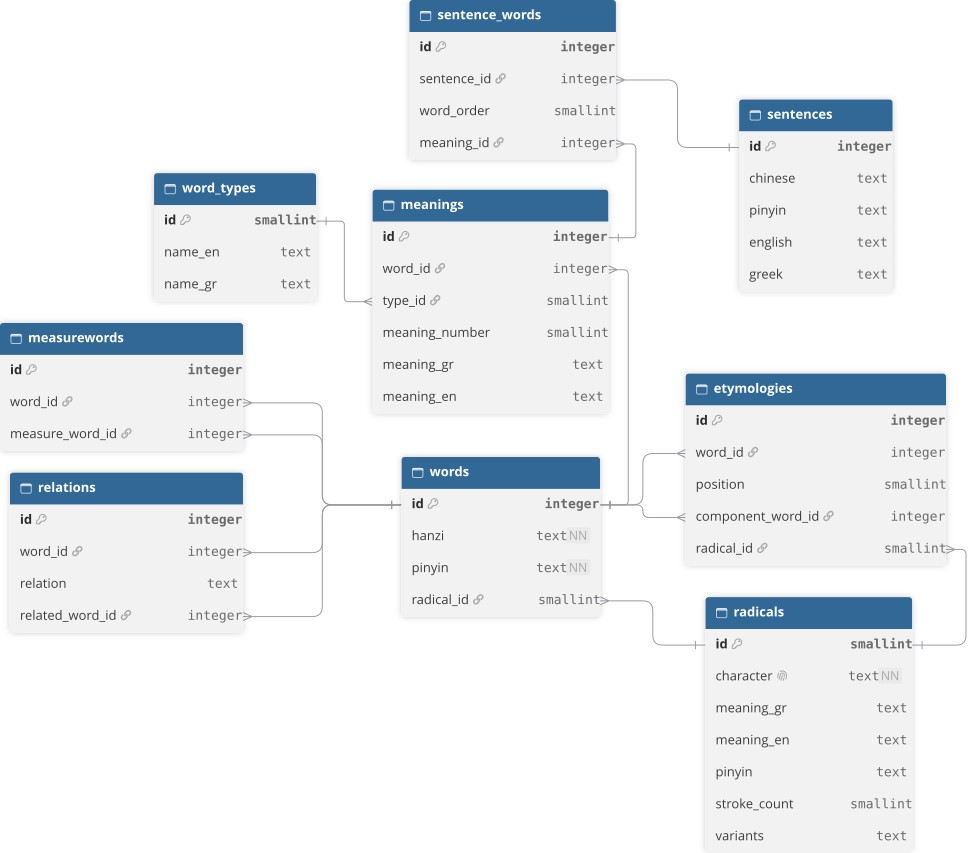

## Chinese Greek English dictionary with component breakdowns


A dictionary with recursive component breakdowns: every word is traced down through its components to the 214 Kangxi radicals.
 
**Live:** [chinesegreek.vercel.app](https://chinesegreek.vercel.app)

### About this project
Built for my dad, a Chinese teacher, from his own vocabulary spreadsheet. The source data was a large, inconsistent Excel file that I cleaned, normalized and restructured into a relational schema.  He can edit entries himself through a login-protected edit mode.

https://github.com/user-attachments/assets/5173f12d-6ed9-430d-a841-22e85c2ed4c7


### Try it
1. Search a word in Chinese, pinyin (with or without tone marks), English or Greek.
2. Open a word to see its meanings, example sentences and etymology.
3. Click a component in the etymology to follow it down to its radical.
4. Click a related word to jump to the words that use this one as a building block.
5. Switch the interface language (EN / GR).
   
### What's inside
 
- **Recursive etymology:** every word is broken down into components, down to the 214 Kangxi radicals, drawn as a tree
- **Search across four kinds of input:** hanzi, pinyin (tone-insensitive, so `ma` finds `mǎ`), English and Greek meanings, with exact matches ranked first
- **Bilingual interface:** English and Greek, falling back to the other language when a translation is missing
- **Rich entries:** pinyin, word type, numbered meanings, example sentences with the target word highlighted, measure words and related words (synonyms, antonyms)
- **Radicals index:** all radicals grouped by stroke count, each with the words that use it
- **Teacher edit mode:** add and edit words, meanings and radicals behind a password
- **Automated checks:** lint, unit tests, end-to-end tests and a Docker build run on GitHub Actions for every pull request and every push to `main`
- **Containerized:** a Dockerfile and a Docker Compose setup start the app and a local PostgreSQL, already filled with the dictionary, with one command

## Tech stack
 
| Area | Tools |
| --- | --- |
| App | Next.js (App Router), React, TypeScript, Tailwind CSS |
| Database | PostgreSQL on Neon, accessed with `pg` |
| Hosting | Vercel |
| Unit and component tests | Vitest |
| End-to-end tests | Playwright (Chromium, Firefox, WebKit) |
| CI | GitHub Actions |
| Containers | Docker |


### Screenshots

#### Main screen


#### Teacher edit word
 

#### Radicals page
 

## Getting started
 
You need Node.js and a PostgreSQL database (the project uses a Neon database) with the schema shown.

### Database Schema
Words point to their components, and components point down to the 214 radicals or other components, which makes the etymology a recursive lookup.


 
```bash
git clone <this repo>
cd <this repo>
npm install
cp .env.example .env.local   # then fill in the values
npm run dev
```
 
| Variable | Purpose |
| --- | --- |
| `DATABASE_URL` | PostgreSQL connection string |
| `AUTH_SECRET` | Long random string used to sign login sessions |
| `TEACHER_PASSWORD` | Password for teacher edit mode |
| `TEST_DATABASE_URL` | Separate database (a Neon branch) used only by the E2E tests |
 
Teacher login is at `/edit`.

 ## Run with Docker

### App and local database with Docker Compose

The quickest way to run everything on your own machine. Compose starts two containers: PostgreSQL 18 and the app.

```bash
docker compose up --build
```

Then open [http://localhost:3000](http://localhost:3000).

- **Database setup:** `database/dictionary3.sql` is mounted into the Postgres container and runs automatically the first time it starts, when its data volume is empty. It contains the schema and the words, so the local app has the full dictionary right away.
- **Startup order:** the app waits until the database reports healthy before it starts.
- **Local credentials:** the database password, `AUTH_SECRET` and `TEACHER_PASSWORD` are throwaway values written in `docker-compose.yml`. They are for local use only. Never reuse them anywhere public. The teacher password for this local setup is `local-docker-only-password`.
- **Starting over:** the data lives in a Docker volume. `docker compose down` keeps it, and `docker compose down -v` deletes it, so the next start loads `dictionary3.sql` again. Edits made through teacher mode are lost this way.

### App image only

The `Dockerfile` starts from Node 22, installs the dependencies, builds the Next.js app and starts it with `npm start`. `.dockerignore` keeps `.env` files, `.git`, `node_modules` and the test folders out of the image, and the `Dockerfile` sets no secrets, so the database connection and passwords are passed in when the container starts.

```bash
docker build -t chinese-dictionary .
docker run --rm -p 3000:3000 --env-file .env.local chinese-dictionary
```

`DATABASE_URL` in your env file must point to a reachable PostgreSQL database, for example your Neon database.
 
## Testing
 
### Unit and component tests (Vitest)
 
```bash
npm test
```
 
Tests live next to the code they cover (`*.test.ts` / `*.test.tsx`). They cover:
 
- the language helpers (`parseLang`, `pickByLang`, relation labels) and a check that the English and Greek dictionaries have identical keys
- id validation, including the Postgres integer and smallint limits that previously caused 500 errors instead of 404s
- the etymology tree: link targets, child ordering, nested components, duplicate rows, circular references and the depth limit
- the highlighted example text
### End-to-end tests (Playwright)
 
```bash
npx playwright install   # once, downloads the browsers
npm run test_e2e
```
 
Tests live in `e2e_tests/` and run in Chromium, Firefox and WebKit. They cover:
 
- searching for a word and opening its page, plus the "no results" state
- word and radical pages, including 404 handling for invalid and out-of-range ids
- the radicals index and language switching
- teacher login and logout, and that anonymous visitors never see the edit controls
- editing a meaning, saving, reloading, and checking the change persisted
Playwright builds the app and starts the production server itself. It points the server at `TEST_DATABASE_URL`, a separate Neon branch, so the tests that edit data never touch production data. The edit test restores the original text when it finishes, even if it fails halfway.

## Continuous integration

The workflow in `.github/workflows/ci.yml` runs on GitHub Actions for every pull request and every push to `main`. A newer push to the same branch cancels the older run. It has three jobs:

| Job | What it does |
| --- | --- |
| Lint and unit tests | Installs dependencies on Node 22, then runs `npm run lint` and the Vitest suite |
| End-to-end tests | Installs the Playwright browsers and runs the full E2E suite against the test database. The HTML report is uploaded as an artifact and kept for 14 days |
| Docker image builds | Builds the Docker image to make sure the `Dockerfile` still works. The image is not pushed anywhere |

The E2E job needs three repository secrets: `TEST_DATABASE_URL`, `AUTH_SECRET` and `TEACHER_PASSWORD`. Because all runs share one test database, E2E runs are queued instead of running at the same time, so tests never overwrite each other's data. The production database is never used in CI.
 
## Project structure
 
```text
app/
  api/search/       search endpoint
  word/[id]/        word page, etymology tree, editor, highlighted text
  radical/[id]/     single radical page
  radicals/         radicals index
  admin/actions.ts  server actions (save word, toggle edit mode)
  helpers/          database pool, auth, i18n, shared UI classes
e2e_tests/          Playwright tests
```
