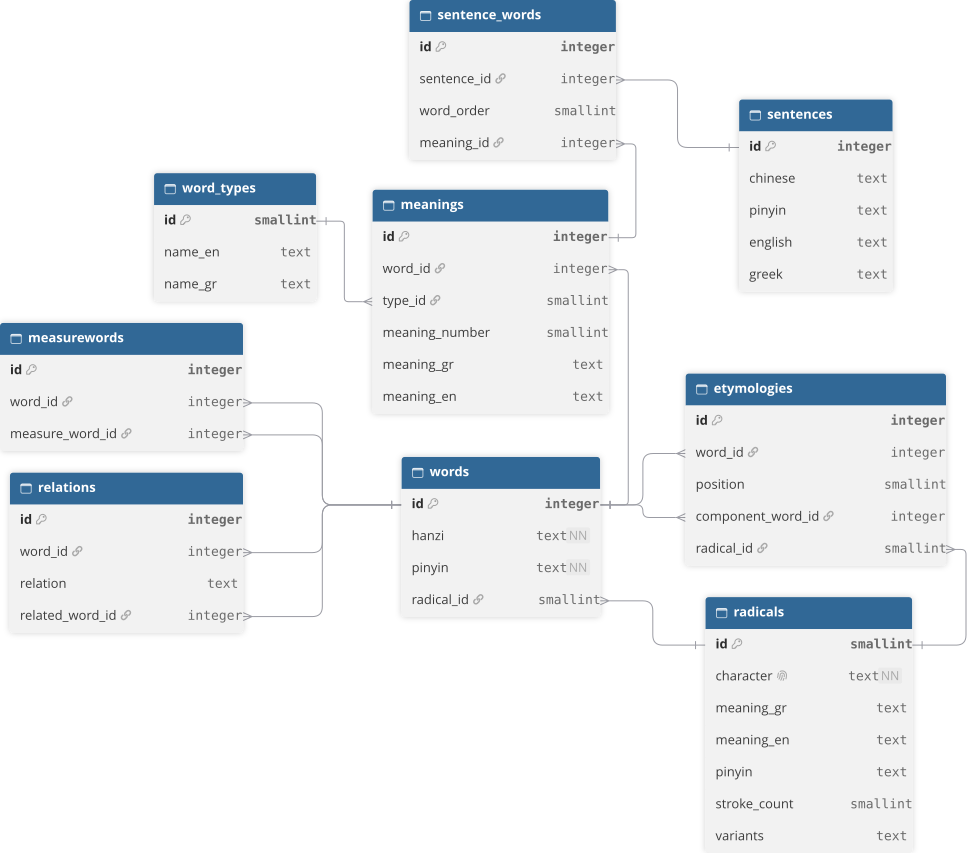

## Chinese Greek English dictionary with component breakdowns

A dictionary with recursive component breakdowns: every word is traced down through its components to the 214 Kangxi radicals.
 
**Live:** [chinesegreek.vercel.app](https://chinesegreek.vercel.app)

### About this project
Built for my dad, a Chinese teacher, from his own vocabulary spreadsheet. The source data was a large, inconsistent Excel file that I cleaned, normalized and restructured into a relational schema.  He can edit entries himself through a login-protected edit mode.

https://github.com/user-attachments/assets/5173f12d-6ed9-430d-a841-22e85c2ed4c7


### Try it
1. Search a word in Chinese, pinyin (with or without tone marks), English or Greek.
2. Open a word to see its meanings, example sentences and etymology.
3. Click a component in the etymology to follow it down to its radical.
4. Click a related word to jump to the words that use this one as a building block.
5. Switch the interface language (EN / GR).
   
### What's inside
 
- **Recursive etymology:** every word is broken down into components, down to the 214 Kangxi radicals, drawn as a tree
- **Search across four kinds of input:** hanzi, pinyin (tone-insensitive, so `ma` finds `mǎ`), English and Greek meanings, with exact matches ranked first
- **Bilingual interface:** English and Greek, falling back to the other language when a translation is missing
- **Rich entries:** pinyin, word type, numbered meanings, example sentences with the target word highlighted, measure words and related words (synonyms, antonyms)
- **Radicals index:** all radicals grouped by stroke count, each with the words that use it
- **Teacher edit mode:** add and edit words, meanings and radicals behind a password


## Tech stack
 
| Area | Tools |
| --- | --- |
| App | Next.js (App Router), React, TypeScript, Tailwind CSS |
| Database | PostgreSQL on Neon, accessed with `pg` |
| Hosting | Vercel |
| Unit and component tests | Vitest |
| End-to-end tests | Playwright (Chromium, Firefox, WebKit) |


### Screenshots

#### Main screen


#### Teacher edit word
 

#### Radicals page
 

## Getting started
 
You need Node.js and a PostgreSQL database (the project uses a Neon database) with the schema shown.

### Database Schema
Words point to their components, and components point down to the 214 radicals or other components, which makes the etymology a recursive lookup.


 
```bash
git clone <this repo>
cd <this repo>
npm install
cp .env.example .env.local   # then fill in the values
npm run dev
```
 
| Variable | Purpose |
| --- | --- |
| `DATABASE_URL` | PostgreSQL connection string |
| `AUTH_SECRET` | Long random string used to sign login sessions |
| `TEACHER_PASSWORD` | Password for teacher edit mode |
| `TEST_DATABASE_URL` | Separate database (a Neon branch) used only by the E2E tests |
 
Teacher login is at `/edit`.
 
## Testing
 
### Unit and component tests (Vitest)
 
```bash
npm test
```
 
Tests live next to the code they cover (`*.test.ts` / `*.test.tsx`). They cover:
 
- the language helpers (`parseLang`, `pickByLang`, relation labels) and a check that the English and Greek dictionaries have identical keys
- id validation, including the Postgres integer and smallint limits that previously caused 500 errors instead of 404s
- the etymology tree: link targets, child ordering, nested components, duplicate rows, circular references and the depth limit
- the highlighted example text
### End-to-end tests (Playwright)
 
```bash
npx playwright install   # once, downloads the browsers
npm run test_e2e
```
 
Tests live in `e2e_tests/` and run in Chromium, Firefox and WebKit. They cover:
 
- searching for a word and opening its page, plus the "no results" state
- word and radical pages, including 404 handling for invalid and out-of-range ids
- the radicals index and language switching
- teacher login and logout, and that anonymous visitors never see the edit controls
- editing a meaning, saving, reloading, and checking the change persisted
Playwright builds the app and starts the production server itself. It points the server at `TEST_DATABASE_URL`, a separate Neon branch, so the tests that edit data never touch production data. The edit test restores the original text when it finishes, even if it fails halfway.
 
## Project structure
 
```text
app/
  api/search/       search endpoint
  word/[id]/        word page, etymology tree, editor, highlighted text
  radical/[id]/     single radical page
  radicals/         radicals index
  admin/actions.ts  server actions (save word, toggle edit mode)
  helpers/          database pool, auth, i18n, shared UI classes
e2e_tests/          Playwright tests
```
