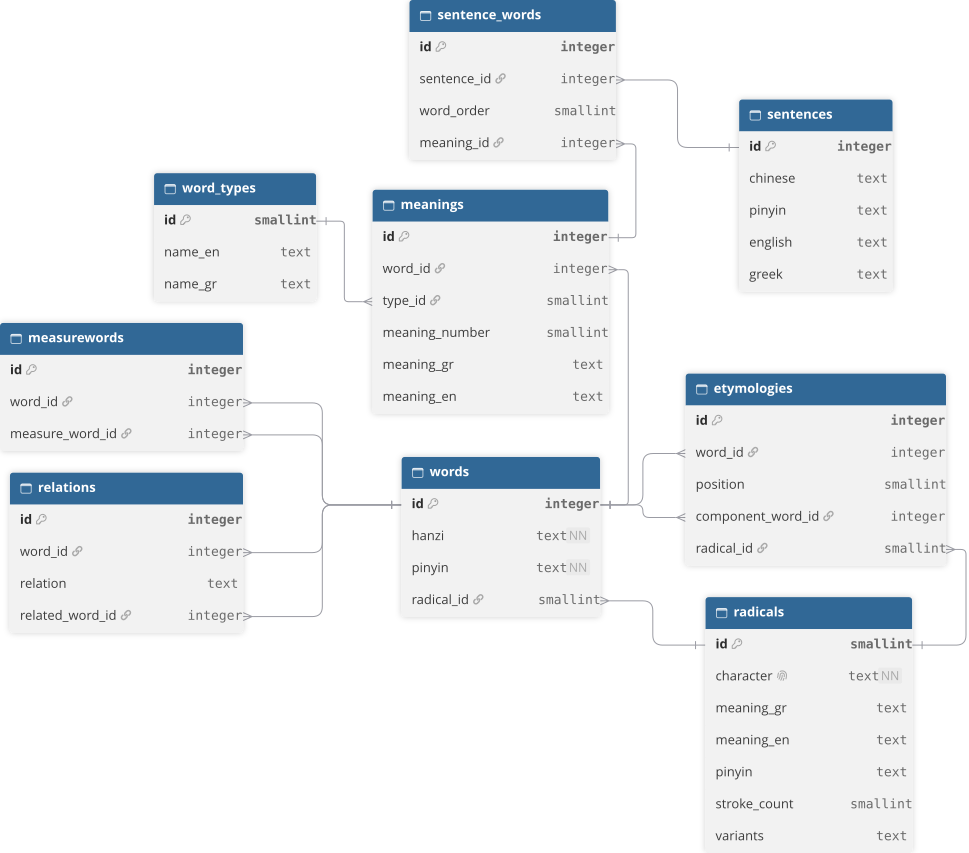

## Chinese Greek English dictionary with component breakdowns

**Live:** [chinesegreek.vercel.app](https://chinesegreek.vercel.app)

### About this project
Built for my dad, a Chinese teacher, from his own vocabulary spreadsheet. The source data was a large, inconsistent Excel file that I cleaned, normalized and restructured into a relational schema.

https://github.com/user-attachments/assets/5173f12d-6ed9-430d-a841-22e85c2ed4c7

### Try it
1. Search a word in Chinese, pinyin (with or without tone marks), English or Greek.
2. Open a word to see its meanings, example sentences and etymology.
3. Click a component in the etymology to follow it down to its radical.
4. Click "related words" to see the words that use this one as a building block.
5. Switch the interface language (EN / EL).
   
### What's inside
- Recursive etymology: every word is broken down into components, down to the 214 Kangxi radicals
- Words with pinyin, word type, English and Greek meanings, and example sentences
- Next.js + PostgreSQL (Neon), deployed on Vercel
- Teacher edit mode for adding and editing words (login required)

### Screenshots

#### Main screen

#### Teacher edit word
 

#### Radicals page
 

### Database Schema
Words point to their components, and components point down to the 214 radicals, which makes the etymology a recursive lookup.

